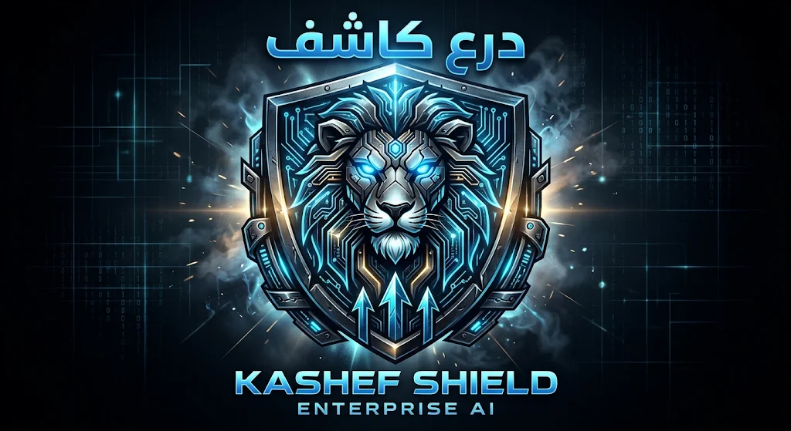

  

  # 🛡️ Kashef Shield Enterprise AI
  ### Autonomous Client-Side SOC & Banking Anti-Fraud Engine

  
  
  
  

  

    <b>منظومة مصرفية سيبرانية ذاتية الإدارة لرصد الاحتيال المالي، وتحليل الروابط المشبوهة، والتصدي للهندسة الاجتماعية لحظياً.</b>
     
    <i>The next-generation browser-native SOC platform engineered for real-time transaction telemetry, hardware fingerprinting, and Anti-Vishing mitigation.</i>
  

  <a href="https://kemo-777.github.io/-Kashef-Shield-/"><strong>⚡ تشغيل المنظومة الحية (Live Platform) »</strong></a>

---

## 📌 نظرة عامة | Overview

**درع كاشف (Kashef Shield Enterprise AI)** هو محرك دفاع سيبراني مصرفي يعمل بالكامل من طرف العميل (Client-Side / In-Browser). تم تصميمه لمعالجة التهديدات الأكثر انتشاراً في القطاع المالي والمصرفي مثل سرقة رموز المصادقة الثنائية (OTP Hijacking)، مكالمات الهندسة الاجتماعية الاحتيالية (Vishing)، والمعاملات غير المصرح بها، دون الاعتماد على خوادم وسيطة تبطئ زمن الاستجابة.

---

## 🚀 الميزات الرئيسية | Key Capabilities

* **🎙️ محرك مكافحة التصيد الصوتي (Real-Time Anti-Vishing Engine):**
  تحليل حي لتدفق الصوت وتفريغ فوري للنصوص عبر *Web Speech API* لاكتشاف الكلمات المفتاحية الاستدراجية (OTP, PIN, CVV) وإطلاق تنبيهات دفاعية صوتية ومرئية فوراً.

* **💳 تدقيق العمليات المصرفية والبصمة الرقمية (Hardware Telemetry):**
  حساب بصمة تشفيرية فريدة للعتاد والمتصفح (SHA-256 Fingerprinting)، وفحص انحرافات المبالغ والمواقع الجغرافية، وتوليد توقيعات إثبات غير قابلة للتلاعب عبر `HMAC-SHA256`.

* **🔗 رصد الروابط الاحتيالية (Phishing & Typosquatting Scanner):**
  كشف محاولات انتحال الصفحات البنكية والنطاقات الشبيهة وروابط التصيد الخبيثة في أجزاء من الثانية.

* **🌐 لوحة تحكم SOC التفاعلية (Interactive SOC Operations):**
  خريطة حية لمسارات التهديد (Threat Map Canvas)، ومخطط بياني حي لسرعة المعاملات عبر *Chart.js*، ومحاكي هجمات متعدد النواقل لاختبار الإجهاد (Stress Simulation).

* **📄 تصدير تقارير جنائية رقمية (Forensic PDF Export):**
  توليد وتصدير سجل تدقيق مصرفي منظم وموثق بضغطة زر لتقديمه لفرق التحقيق الجنائي والأمني.

* **🌍 دعم متعدد اللغات والاتجاهات (Multi-Lingual Engine):**
  واجهة مجهزة بـ 20 لغة عالمية مع تبديل تلقائي للاتجاه (RTL / LTR) وسمات بصرية متقدمة (Neon, Dark, Light).

---

## ⚙️ المعمارية التقنية | Core Architecture